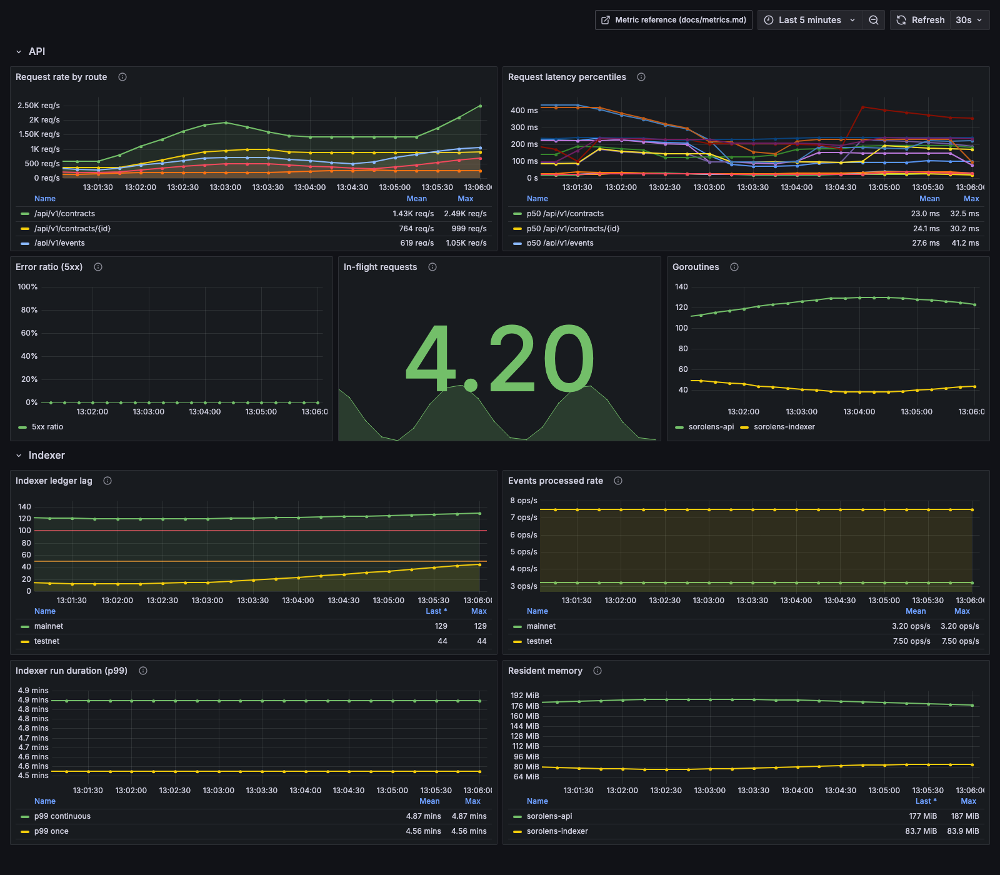
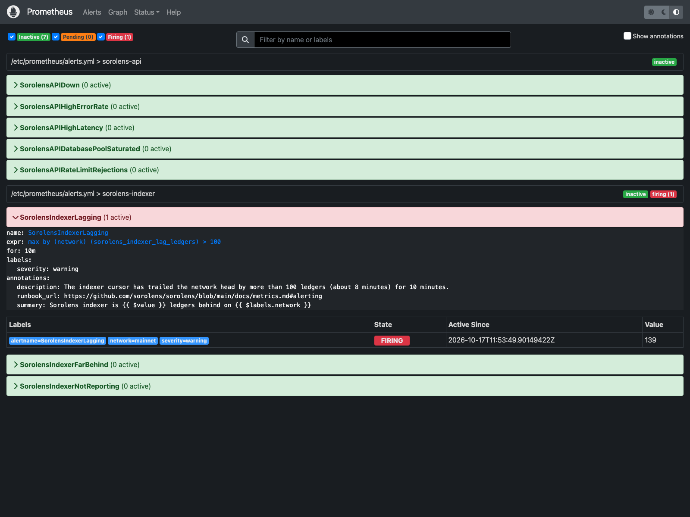

# Metrics

Sorolens exposes operational metrics in the [Prometheus text exposition
format](https://prometheus.io/docs/instrumenting/exposition_formats/) from both
the API and the indexer. This page documents the metric names, their labels, and
how to scrape them.

- [Endpoints](#endpoints)
- [Metric catalogue](#metric-catalogue)
  - [API](#api)
  - [Postgres pool](#postgres-pool)
  - [Indexer](#indexer)
  - [Default Go collectors](#default-go-collectors)
- [Example queries](#example-queries)
- [Scrape configuration](#scrape-configuration)
- [Alerting](#alerting)
- [Grafana dashboard](#grafana-dashboard)
- [Validating the artifacts](#validating-the-artifacts)
- [Adding a metric](#adding-a-metric)

---

## Endpoints

| Service            | Endpoint       | Auth | Default address                  |
| ------------------ | -------------- | ---- | -------------------------------- |
| API                | `GET /metrics` | none | `PORT` (8080)                    |
| API admin listener | `GET /metrics` | none | `METRICS_PORT` (only if set)     |
| Indexer            | `GET /metrics` | none | `INDEXER_METRICS_ADDR` (`:9100`) |

Both services return the Prometheus text exposition format
(`Content-Type: text/plain; version=0.0.4`).

The API always serves `GET /metrics` on its main port, so the acceptance
criterion holds with a plain:

```bash
curl -s localhost:8080/metrics
```

Set `METRICS_PORT` to additionally serve the endpoint on a dedicated admin
listener, which is the recommended production setup: the port can be bound to a
private interface and excluded from the public ingress.

```bash
# API on :8080, metrics also on :9090
METRICS_PORT=9090 go run ./cmd/api
```

The indexer serves `/metrics` on `INDEXER_METRICS_ADDR` (default `:9100`). Set
`INDEXER_METRICS_ADDR=` (empty) to disable the endpoint.

```bash
curl -s http://localhost:9100/metrics | grep sorolens_indexer
```

The endpoint is owned by the indexer because the indexer is the component that
talks to each network's Soroban RPC and owns the per-network ledger cursor.

The scrape endpoint is exempt from the API rate limiter (`middleware.RateLimit`)
so that a scrape can never be throttled and never consumes another caller's
budget. The exemption is visible on the limiter counter below as
`result="exempt"`.

---

## Metric catalogue

All Sorolens metrics are prefixed `sorolens_` so they are easy to select in
PromQL:

```
{__name__=~"sorolens_.*"}
```

### API

| Metric                                   | Type      | Labels                      | Description                                                                                                |
| ---------------------------------------- | --------- | --------------------------- | ---------------------------------------------------------------------------------------------------------- |
| `sorolens_http_requests_total`           | Counter   | `method`, `route`, `status` | Completed HTTP requests.                                                                                   |
| `sorolens_http_request_duration_seconds` | Histogram | `method`, `route`, `status` | Request latency in seconds.                                                                                |
| `sorolens_http_requests_in_flight`       | Gauge     | –                           | Requests currently being served.                                                                           |
| `sorolens_api_cache_requests_total`      | Counter   | `namespace`, `result`       | Response cache lookups. `namespace` is `contracts`, `watchdog`, or `labels`; `result` is `hit` or `miss`.  |
| `sorolens_api_cache_purges_total`        | Counter   | `namespace`                 | Cache namespace purges triggered by a successful write (e.g. `POST /api/v1/contracts` purges `contracts`). |
| `sorolens_api_ratelimit_requests_total`  | Counter   | `result`, `tier`            | Every request the rate limiter evaluates. `result` is `allowed`, `limited` (answered 429), `exempt` (health, version and scrape endpoints) or `error` (Redis failed open); `tier` is `anonymous` or `authenticated` for a request that presented an API key. |

The `route` label is the **chi route pattern**, not the raw request path — for
example `/api/v1/contracts/{id}` rather than
`/api/v1/contracts/CDLZFC3S...`. This keeps label cardinality bounded no matter
how many distinct contract IDs are requested. Paths that match no route are
folded into a fixed set of labels as well: a root-level 404 becomes
`route="unmatched"`, and a 404 beneath a mounted subtree becomes that mount's
wildcard pattern (`/api/v1/*`). No request can mint a new label value.

Both `result` and `tier` on `sorolens_api_ratelimit_requests_total` are closed
sets, so the metric has a hard ceiling of 4 × 2 = 8 series.

Histogram buckets are the Prometheus defaults (`prometheus.DefBuckets`), from
0.005s to 10s.

Hit ratio per namespace:

```promql
sum by (namespace) (rate(sorolens_api_cache_requests_total{result="hit"}[5m]))
  /
sum by (namespace) (rate(sorolens_api_cache_requests_total[5m]))
```

Cached responses also carry an `X-Cache: HIT|MISS` header, which is handy when
checking a single request with `curl -i`.

### Postgres pool

A snapshot of the API's `pgxpool` connection pool, read from `Pool.Stat()` on
every scrape (no background sampler). The series carry **no labels at all**, so
the family is a fixed 13 series in every deployment.

| Metric                                          | Type    | Description                                                                                                          |
| ------------------------------------------------ | ------- | -------------------------------------------------------------------------------------------------------------------- |
| `sorolens_db_pool_acquires_total`                | Counter | Successful acquires from the pool.                                                                                    |
| `sorolens_db_pool_acquire_duration_seconds_total` | Counter | Cumulative time spent waiting on acquires.                                                                            |
| `sorolens_db_pool_empty_acquires_total`          | Counter | Acquires that had to wait because the pool held no idle connection — the saturation signal.                            |
| `sorolens_db_pool_empty_acquire_wait_seconds_total` | Counter | Cumulative time spent waiting on an empty pool.                                                                     |
| `sorolens_db_pool_canceled_acquires_total`       | Counter | Acquires canceled by a request context (client gone or deadline hit).                                                 |
| `sorolens_db_pool_new_connections_total`          | Counter | New connections opened by the pool.                                                                                   |
| `sorolens_db_pool_connections_destroyed_lifetime_total` | Counter | Connections destroyed after exceeding the maximum connection lifetime.                                          |
| `sorolens_db_pool_connections_destroyed_idle_total` | Counter | Connections destroyed after exceeding the maximum idle time.                                                        |
| `sorolens_db_pool_acquired_connections`           | Gauge   | Connections currently checked out.                                                                                    |
| `sorolens_db_pool_idle_connections`               | Gauge   | Connections currently idle.                                                                                           |
| `sorolens_db_pool_constructing_connections`       | Gauge   | Connections the pool is currently constructing.                                                                       |
| `sorolens_db_pool_total_connections`              | Gauge   | Connections held by the pool (acquired + idle + constructing).                                                        |
| `sorolens_db_pool_max_connections`                | Gauge   | Configured pool ceiling.                                                                                              |

The collector is inert until a pool is wired (`metrics.SetPool` at startup),
so an entrypoint that never connects to Postgres reports no pool series rather
than misleading zeros.

### Indexer

Every metric carries a `network` label. Its value is the configured network
(`testnet`, `mainnet`, or `futurenet`); when the indexer is wired with a single
unnamed RPC client, the value is `default`.

| Metric                                    | Type      | Labels    | Description                                                                                                                                                                                      |
| ----------------------------------------- | --------- | --------- | ------------------------------------------------------------------------------------------------------------------------------------------------------------------------------------------------ |
| `sorolens_indexer_lag_ledgers`            | Gauge     | `network` | Number of ledgers between the network head and the last ledger the indexer has committed for that network: `latest_ledger - last_indexed_ledger`. **This is the primary indexer health signal.** |
| `sorolens_indexer_head_ledger`            | Gauge     | `network` | Latest ledger sequence reported by the network's Soroban RPC.                                                                                                                                    |
| `sorolens_indexer_last_indexed_ledger`    | Gauge     | `network` | Last ledger sequence committed by the indexer for the network (its indexer cursor).                                                                                                              |
| `sorolens_indexer_events_processed_total` | Counter   | `network` | Contract events persisted.                                                                                                                                                                       |
| `sorolens_indexer_run_duration_seconds`   | Histogram | `mode`    | Duration of a full indexer pass (`once` or `continuous`).                                                                                                                                        |

Notes:

- Metrics are sampled after a batch has committed, so they always describe
  durable progress rather than in-flight work.
- `lag_ledgers` is clamped at zero; a cursor that briefly reads ahead of the
  head never reports a negative gauge.
- `events_processed_total` only counts events after the batch insert succeeds; a
  failed insert does not increment it, and a zero increment never creates a
  series.
- `run_duration_seconds` buckets extend to 300s to cover the `INDEXER_MAX_DURATION`
  default of 270s.

### Default Go collectors

Both services also register the standard Go and process collectors:

| Metric family | Description                                                      |
| ------------- | ---------------------------------------------------------------- |
| `go_*`        | Goroutines, GC pauses, heap and stack usage, `go_info`.          |
| `process_*`   | CPU seconds, open file descriptors, resident memory, start time. |

The most useful of these for operators are `go_goroutines` (leak detection),
`go_gc_duration_seconds`, and `process_resident_memory_bytes`.

---

## Example queries

**Request rate per route**

```promql
sum by (route) (rate(sorolens_http_requests_total[5m]))
```

**p95 latency per route**

```promql
histogram_quantile(
  0.95,
  sum by (route, le) (rate(sorolens_http_request_duration_seconds_bucket[5m]))
)
```

**5xx error ratio**

```promql
sum(rate(sorolens_http_requests_total{status=~"5.."}[5m]))
  /
sum(rate(sorolens_http_requests_total[5m]))
```

**Rate-limited request ratio**

```promql
sum(rate(sorolens_api_ratelimit_requests_total{result="limited"}[5m]))
  /
sum(rate(sorolens_api_ratelimit_requests_total[5m]))
```

**Connection pool saturation**

```promql
sorolens_db_pool_acquired_connections
  /
sorolens_db_pool_max_connections
```

**Requests waiting on an empty pool**

```promql
rate(sorolens_db_pool_empty_acquires_total[5m])
```

**Indexer falling behind** (alert when lag exceeds 100 ledgers for 10 minutes)

```promql
max by (network) (sorolens_indexer_lag_ledgers) > 100
```

**Indexing throughput**

```promql
sum by (network) (rate(sorolens_indexer_events_processed_total[5m]))
```

**Indexer run duration p99**

```promql
histogram_quantile(
  0.99,
  sum by (mode, le) (rate(sorolens_indexer_run_duration_seconds_bucket[1h]))
)
```

---

## Scrape configuration

```yaml
scrape_configs:
  - job_name: sorolens-api
    metrics_path: /metrics
    static_configs:
      - targets: ["api.internal:9090"] # METRICS_PORT

  - job_name: sorolens-indexer
    metrics_path: /metrics
    static_configs:
      - targets: ["indexer.internal:9100"] # INDEXER_METRICS_ADDR
```

Because the indexer runs as a cron job (GitHub Actions) in the default
deployment, its metrics are only scrapeable while a process is running. Run it
with `--mode continuous` to keep the endpoint up; see
[`ARCHITECTURE.md` § 5.1](../ARCHITECTURE.md) for the migration path from cron
to a persistent worker.

---

## Alerting

Ready-to-load Prometheus rules are checked in at
[`docs/alerts.yml`](alerts.yml). They cover API availability, 5xx error ratio,
p95 latency, Postgres pool saturation, rate-limit rejections, and indexer lag.
Every rule carries `severity` and `runbook_url` labels/annotations.

| Alert | Expression summary | For | Severity |
| ----- | ------------------ | --- | -------- |
| `SorolensAPIDown` | `up{job="sorolens-api"} == 0` | 5m | critical |
| `SorolensAPIHighErrorRate` | 5xx share > 5% | 10m | warning |
| `SorolensAPIHighLatency` | p95 latency > 1s | 10m | warning |
| `SorolensAPIDatabasePoolSaturated` | pool > 90% acquired | 10m | warning |
| `SorolensAPIRateLimitRejections` | limited share > 10% | 15m | info |
| `SorolensIndexerLagging` | lag > 100 ledgers | 10m | warning |
| `SorolensIndexerFarBehind` | lag > 1000 ledgers | 15m | critical |
| `SorolensIndexerNotReporting` | lag metric absent | 15m | warning |

Install and validate:

```bash
# 1. Check the file before deploying it.
promtool check rules docs/alerts.yml

# 2. Add the path to the rule_files list in prometheus.yml (merge it into an
#    existing rule_files section if there is one).
#      rule_files:
#        - /etc/prometheus/alerts.yml
cp docs/alerts.yml /etc/prometheus/alerts.yml

# 3. Reload Prometheus (or send SIGHUP).
curl -X POST http://localhost:9090/-/reload
```

Confirm the groups loaded:

```bash
curl -s http://localhost:9090/api/v1/rules | jq '.data.groups[].name'
# "sorolens-api"
# "sorolens-indexer"
```

The `job` label in `SorolensAPIDown` must match your scrape job. The checked-in
file assumes the `sorolens-api` and `sorolens-indexer` job names from the
[scrape configuration](#scrape-configuration) above; rename them together if
your deployment differs.

Pick lag thresholds from your network's ledger time. On Stellar a ledger closes
roughly every 5 seconds, so 100 ledgers is about 8 minutes of lag and 1000
ledgers is about 83 minutes. The API thresholds (1s p95, 5% 5xx) are starting
points; tighten them once you have a week of production data.

`SorolensIndexerNotReporting` is intended for continuous-mode deployments. In
the default cron deployment the indexer exposes metrics only while a pass is
running, so the rule will fire between runs; drop it if you run on cron.

---

## Grafana dashboard

A ready-to-import dashboard is checked in at
[`docs/dashboards/sorolens-overview.json`](dashboards/sorolens-overview.json).



Import it via **Dashboards → New → Import → Upload JSON file**, then pick the
Prometheus datasource when prompted (the dashboard input is `DS_PROMETHEUS`).
The dashboard covers request rate, latency percentiles, error ratio, in-flight
requests, indexer lag, indexing throughput, indexer pass duration, goroutines,
and RSS.

For a GitOps setup, provision the file instead of importing it by hand:

```yaml
# /etc/grafana/provisioning/dashboards/sorolens.yaml
apiVersion: 1
providers:
  - name: sorolens
    folder: Sorolens
    type: file
    options:
      path: /var/lib/grafana/dashboards
```

Copy `docs/dashboards/sorolens-overview.json` into that path and set
`DS_PROMETHEUS` to your datasource UID (or keep the import prompt). The panels
and the Prometheus rule thresholds use the same metric names, so the dashboard
and the alerts stay in sync.



---

## Validating the artifacts

Both checked-in observability artifacts are plain files that can be validated in
CI or locally:

```bash
# Alert rules (requires promtool; also available in the prom/prometheus image).
promtool check rules docs/alerts.yml

# Dashboard JSON: parse and sanity-check required keys.
jq -e '.title and .panels and .__inputs' docs/dashboards/sorolens-overview.json

# Optional: validate the dashboard against a running Grafana.
curl -s -u admin:admin http://localhost:3000/api/dashboards/uid/sorolens-overview \
  | jq -e '.dashboard.title == "Sorolens Overview"'
```

If promtool is not installed locally, use the published image from the repo
root:

```bash
docker run --rm --entrypoint promtool \
  -v "$PWD/docs:/docs:ro" prom/prometheus:latest check rules /docs/alerts.yml
```

---

## Adding a metric

1. Add the collector in the relevant `internal/metrics` package and register it
   on the recorder's registry in `New` (indexer) or the package registry
   (API).
2. Update it from the owner of the data (the poller for indexer metrics, the
   middleware for API request metrics), keeping updates best-effort so metrics
   never fail a request or an indexing pass.
3. Document it in the table above.
4. Keep the `sorolens_` namespace and stable labels (`network` for indexer
   metrics, `method`/`route`/`status` for HTTP metrics) so dashboards and alerts
   stay consistent.
